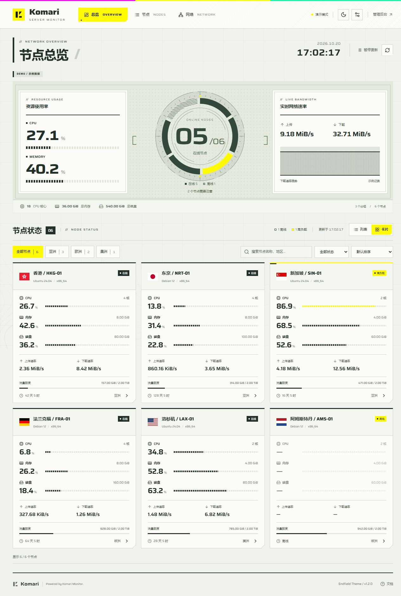

# Komari Endfield Theme

终末地风格的 Komari 监控主题，支持明暗外观、交互地球与主机信息卡片。

<p align="center">
  
</p>

## 预览



## 安装与更新

1. 从 [Releases](https://github.com/BakaNoble/komari-endfield-theme/releases/latest) 下载 `komari-endfield-*.zip`。
2. 在 Komari 后台上传主题包，应用 **Endfield / 终末地**。
3. 在 **Endfield 外观设置** 中调整主题、主机布局和动效范围。

请下载主题 ZIP，GitHub 自动生成的 **Source code** 压缩包无法直接安装。后台外观配置需要 Komari 1.0.5+。

主题已配置 GitHub 仓库地址，后续可通过 Komari 后台的“更新”获取最新版本。

## 功能

- 总览：信息圆环、CPU / 内存 / 磁盘使用率、带宽与运行时间。
- 节点：处理器、核心数、系统环境、内存／磁盘容量、运行时间；有到期日期时显示剩余天数及到期提醒。
- 网络：交互地球、各主机按自己的测试点展示彩色实线；图例可突出单条曲线，详情逐点显示平均延迟、丢包和独立曲线，支持统计范围切换。
- 地区国旗、分组、搜索、筛选、排序，以及节点详情和历史曲线。
- 三个页面分别配置并记忆列表／卡片显示，支持后台默认值和前台独立调整。
- 地球固定俯仰、仅绕 Y 轴旋转，点击地区平滑定位；支持拖动、缩放、暂停和筛选，位置为国家／地区示意。
- 深浅主题及对应列表表头、四种强调色、紧凑列表，适配手机和桌面。
- 圆环鼠标跟随偏转，可选择“仅组件”或“整个页面”；支持减少动态效果。

延迟数据读取后台已配置的 [Ping 任务与记录](https://komari-document.pages.dev/dev/api#_3-11-节点-ping-记录)，未配置时显示空状态。

## 本地开发

需要 Node.js 22.18+ 或 24 LTS。

```sh
npm ci
npm run dev
```

演示地址：`http://127.0.0.1:5173/themes/Endfield/dist/?demo=1`。

连接真实实例：将 `.env.example` 复制为 `.env.local`，填写 `KOMARI_API_TARGET`，重启开发服务并移除 `?demo=1`。

## 打包与发布

```sh
npm test
npm run package
```

安装包和 SHA-256 校验文件生成在 `release/`。

同步更新 `komari-theme.json`、`package.json` 和 `package-lock.json` 的版本号并推送到 `main`，GitHub Actions 会自动打包并发布。也可在 **Actions → Release theme → Run workflow** 手动运行；已有版本不会覆盖。

## 许可

代码采用 [MIT](LICENSE)。设计基于 [endfield-ui-skill](https://github.com/hhikr/endfield-ui-skill)，字体及第三方资源见 [THIRD_PARTY_NOTICES.md](THIRD_PARTY_NOTICES.md)。
